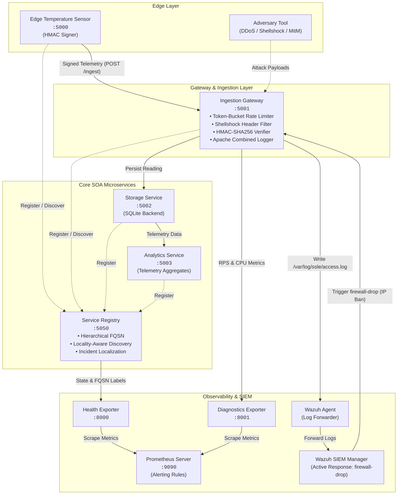

# System developed for SSLE Course

This is the system developed for the first project of the SSLE course (Security in Large Scale Systems — *Segurança de Sistemas de Larga Escala*, University of Aveiro).


## Table of Contents

- [Repository Structure](#repository-structure)
- [Architecture & Overview](#architecture--overview)
- [Getting Started](#getting-started)
  - [Send Code to the VM](#send-code-to-the-vm)
  - [Option 1: Standalone Showcase & Interactive Demo (`./run.sh`)](#option-1-standalone-showcase--interactive-demo-runsh)
  - [Option 2: Complete Incus Container Infrastructure (`./deploy.sh`)](#option-2-complete-incus-container-infrastructure-deploysh)
  - [Option 3: Automated CI Regression Suite (`./test_runner.sh`)](#option-3-automated-ci-regression-suite-test_runnersh)
- [The Three Syllabus Threats & Countermeasures](#the-three-syllabus-threats--countermeasures)
- [Autonomous FCAPS Event Correlation](#autonomous-fcaps-event-correlation)
- [Quantitative Scalability & Bandwidth Optimization](#quantitative-scalability--bandwidth-optimization)
- [Live Demonstration Runbook](#live-demonstration-runbook)
- [Documentation & Final Report](#documentation--final-report)


## Repository Structure

- **[README.md](README.md)**: this document.

- **[DEMO_RUNBOOK.md](DEMO_RUNBOOK.md)**: step-by-step presentation runbook and checklist for the in-class live evaluation.

- **[deploy.sh](deploy.sh)**: master Incus orchestrator deploying all 7 microservices, Prometheus monitoring, and Wazuh SIEM into Linux containers.

- **[cleanup.sh](cleanup.sh)**: master Incus teardown script that cleanly stops and removes all containers and shared host volumes.

- **[run.sh](run.sh)**: standalone 9-stage showcase harness orchestrating the full system on localhost with health checks, threat demonstrations, FCAPS correlation, and scalability benchmarks.

- **[test_runner.sh](test_runner.sh)**: automated isolated CI regression test runner. Runs all 8 validation stages across dedicated high-range ports.

- **[build_binaries.sh](build_binaries.sh)**: build script compiling all static Go binaries into the `./bin/` directory.

- **cmd**: Go source code for all system microservices, exporters, and attacker simulation tools.
  - **[cmd/registry](cmd/registry)**: Service Registry with Hierarchical FQSN, locality-aware discovery, and rapid incident localization.
  - **[cmd/ingestion](cmd/ingestion)**: IoT data ingestion gateway with rate limiting, input bounds checking, Shellshock header filtering, and HMAC-SHA256 signature verification.
  - **[cmd/storage](cmd/storage)**: SQLite persistent storage service for telemetry data.
  - **[cmd/analytics](cmd/analytics)**: analytics worker calculating aggregate temperature statistics.
  - **[cmd/temperature](cmd/temperature)**: simulated IoT edge temperature sensor emitting HMAC-signed readings.
  - **[cmd/attacker](cmd/attacker)**: multi-mode adversary simulator (DDoS flood, Shellshock CVE-2014-6271, rogue deregistration, data tampering).
  - **[cmd/health_exporter](cmd/health_exporter)**: Prometheus exporter exposing service health states with physical and logical location labels.
  - **[cmd/diagnostics_exporter](cmd/diagnostics_exporter)**: Prometheus exporter tracking requests per second and CPU usage.
  - **[cmd/pushgateway_publisher](cmd/pushgateway_publisher)**: Prometheus Pushgateway publisher answering the Guide 3 challenge.

- **internal**: internal Go modules shared across services.
  - **[internal/models](internal/models)**: data models for telemetry payloads, service metadata, and hierarchical location (FQSN).
  - **[internal/function](internal/function)**: locality-aware service discovery algorithms and routing logic.

- **monitoring**: observability and SIEM configuration files.
  - **[monitoring/prometheus.yml](monitoring/prometheus.yml)**: Prometheus scrape configuration and service endpoints.
  - **[monitoring/prometheus_alerts.yml](monitoring/prometheus_alerts.yml)**: Prometheus alerting rules for latency thresholds, crashes, and resource limits.
  - **[monitoring/deploy_monitoring.sh](monitoring/deploy_monitoring.sh)**: standalone Prometheus container deployment script.
  - **[monitoring/wazuh](monitoring/wazuh)**: Wazuh SIEM configuration, including custom detection rules (`local_rules.xml`), decoders, and AlienVault IP reputation lists.

- **scripts**: automated attack, benchmark, and fault management scripts.
  - **[scripts/demonstrate_three_threats.sh](scripts/demonstrate_three_threats.sh)**: unified script demonstrating all three syllabus threats (Shellshock, DDoS, and MitM).
  - **[scripts/fcaps_event_correlator.py](scripts/fcaps_event_correlator.py)**: autonomous 5-stage FCAPS event correlation engine for incident detection and root-cause analysis.
  - **[scripts/run_ddos_benchmark.sh](scripts/run_ddos_benchmark.sh)**: automated DDoS benchmark script measuring p50/p95 latencies and throughput under attack.
  - **[scripts/run_scalability_benchmark.sh](scripts/run_scalability_benchmark.sh)**: registry scale-up (up to 1,000 services) and WAN bandwidth optimization benchmark.
  - **[scripts/set_target_limits.sh](scripts/set_target_limits.sh)**: helper to set Incus CPU and memory cgroups resource limits.
  - **[scripts/deploy_ddos_clients.sh](scripts/deploy_ddos_clients.sh)**: script to deploy botnet client containers.
  - **[scripts/deploy_mitm_topology.sh](scripts/deploy_mitm_topology.sh)**: script to set up dual-subnet route interception topology for MitM testing.
  - **[scripts/generate_certs.sh](scripts/generate_certs.sh)**: certificate generation script for TLS and mTLS verification.

- **docs**: technical documentation, threat modeling, and lab guide reports.
  - **[docs/three_threats_evaluation.md](docs/three_threats_evaluation.md)**: comprehensive evaluation of the three chosen threats according to syllabus criteria.
  - **[docs/attack_defense_tree.md](docs/attack_defense_tree.md)**: formal Attack-Defense Trees for the three syllabus threats.
  - **[docs/fcaps_fault_management.md](docs/fcaps_fault_management.md)**: 5-stage FCAPS fault management specifications and correlation matrices.
  - **[docs/scalability_evaluation.md](docs/scalability_evaluation.md)**: quantitative scalability models, Big-O analysis, and bandwidth savings proofs.
  - **[docs/guide3_monitoring_and_defense.md](docs/guide3_monitoring_and_defense.md)**: Guide 3 Prometheus monitoring and defense countermeasures.
  - **[docs/guide4_siem_wazuh.md](docs/guide4_siem_wazuh.md)**: Guide 4 Wazuh SIEM integration, log forwarding, and active response.
  - **[docs/guide5_ddos_and_hardening.md](docs/guide5_ddos_and_hardening.md)**: Guide 5 DDoS simulation and target hardening.
  - **[docs/guide5_mitm_and_cryptography.md](docs/guide5_mitm_and_cryptography.md)**: Guide 5 Route Hijacking and cryptographic integrity.

- **report**: academic project report in LaTeX format.
  - **[report/main.pdf](report/main.pdf)**: compiled final project evaluation report.
  - **[report/main.tex](report/main.tex)**: root LaTeX source document.
  - **[report/sections](report/sections)**: individual LaTeX sections (Introduction, State of the Art, Architecture, Risk Management, Threats, FCAPS, Evaluation, Conclusion).


## Architecture & Overview

The system implements a resilient, monitored Service-Oriented Architecture (SOA) IoT data ingestion pipeline written in Go. It supports deployment directly on localhost or across isolated Linux Containers (Incus), coupled with real-time Prometheus observability and Wazuh SIEM intrusion detection.




## Getting Started

### Send Code to the VM
To synchronize this repository with the remote Kali VM:
```bash
rsync -avz --delete ./ kali-vm:~/Desktop/ssle/
```

Before running, compile static binaries into `./bin/`:
```bash
./build_binaries.sh
```

---

### Option 1: Standalone Showcase & Interactive Demo (`./run.sh`)

Ideal for quick development, automated validation, and live interactive queries on localhost:
```bash
# Run the complete 9-stage automated showcase and keep services running for inspection:
./run.sh --keep-alive
```
* Options:
  * `-k`, `--keep-alive`: keeps all 7 microservices running after the demo for manual `curl` inspection.
  * `-a`, `--auto`: non-interactive execution for continuous integration pipelines.

---

### Option 2: Complete Incus Container Infrastructure (`./deploy.sh`)

Deploy all 7 microservices, Prometheus monitoring, and Wazuh SIEM into isolated Incus system containers:
```bash
./deploy.sh
```
* Options:
  * `./deploy.sh --skip-monitoring` (Omit Prometheus container).
  * `./deploy.sh --skip-wazuh` (Omit Wazuh SIEM manager/agent).

**Inspect running containers and IP addresses:**
```bash
incus list
```

**Access a container shell:**
```bash
incus exec <container_name> -- sh
# OR
incus shell <container_name>
```

**Clean teardown:**
Stops and deletes all containers and purges the shared host storage:
```bash
./cleanup.sh
```

---

### Option 3: Automated CI Regression Suite (`./test_runner.sh`)

Runs the entire testing infrastructure across 8 sequential validation phases under strict isolation (temporary SQLite database and dedicated high-range ports `15050`, `15001-15003`, `18000-18001`):
```bash
./test_runner.sh
```
* Ensures zero disruption to any existing services running on default ports.
* Automatically traps termination signals (`EXIT`, `INT`, `TERM`) for clean teardown.


## The Three Syllabus Threats & Countermeasures

The project implements and defends against the three formal threats chosen according to syllabus criteria:

| Threat | Syllabus Area | Primary Detection | Primary Defense | SIEM Rule & Active Response |
| :--- | :--- | :--- | :--- | :--- |
| **1. Shellshock (CVE-2014-6271)** | Reputation Systems & Exploitation | Access Log Pattern Regex | Application Filter (`403 Forbidden`) | Rule 100100 $\rightarrow$ `firewall-drop` (60s IP Ban) |
| **2. DDoS / Botnet Flood** | Massive DoS Disruptions & Botnets | Prometheus `p95` Latency & RPS | Token Bucket (`429`) & Incus cgroups | Rule 100102 $\rightarrow$ `firewall-drop` (60s IP Ban) |
| **3. Route Hijacking & Tampering** | Route & Signals Hijacking | Ingestion Signature & Timestamp Drift | HMAC-SHA256 (`401`) & TLS/mTLS | Rule 100104 $\rightarrow$ `firewall-drop` (60s IP Ban) |

### Run the Unified Three Threats Demonstrator
Demonstrates and validates all three threats in sequence against live or containerized endpoints:
```bash
./scripts/demonstrate_three_threats.sh http://localhost:5001 http://localhost:5050
```


## Autonomous FCAPS Event Correlation

The system implements the 5-stage Fault Management cycle bridging operational metrics with security logs:
1. **Detecting:** Prometheus scrapers monitor response latency and error rates defined in [`monitoring/prometheus_alerts.yml`](monitoring/prometheus_alerts.yml).
2. **Diagnosing & Isolating:** Registry rapid incident localization (`GET /services/locate/{id}`) instantly maps alerts to physical host (`kali-vm`) and container (`incus:ssle-ingestion`).
3. **Correlating:** Bridges metrics with Wazuh rules and Apache access logs for root-cause analysis.
4. **Resolution / Mitigation:** Automated Active Response (`firewall-drop` IP ban) or container restart.
5. **Post-Mortem:** Validates baseline recovery and outputs structured JSON incident logs.

**Run the autonomous correlator:**
```bash
python3 ./scripts/fcaps_event_correlator.py \
  --registry http://localhost:5050 \
  --health-exp http://localhost:8000 \
  --diag-exp http://localhost:8001 \
  --access-log /var/log/ssle/ingestion_access.log \
  --service ingestion
```


## Quantitative Scalability & Bandwidth Optimization

* **Registry Scaling:** $\mathcal{O}(1)$ direct key lookups remain sub-millisecond ($p50 \approx 0.46\text{ ms}$) across 500+ services with $< 1.2\text{ MB}$ memory footprint.
* **Locality-Aware Bandwidth Optimization:** `DiscoverLocally()` routes queries to intra-zone endpoints first, delivering **99.99% WAN bandwidth savings** ($18.51\text{ Mbps} \rightarrow 0.0002\text{ Mbps}$).

**Run the scalability benchmark suite:**
```bash
./scripts/run_scalability_benchmark.sh http://localhost:5050 http://localhost:5001
```


## Live Demonstration Runbook

For the in-class live demonstration with the professor, refer to [`DEMO_RUNBOOK.md`](DEMO_RUNBOOK.md) for an ordered presentation runbook detailing:
- Cluster startup commands (Incus containers & Standalone mode).
- Triggering and verifying each of the **Three Syllabus Threats** (Shellshock, DDoS, MitM).
- Wazuh Active Response (`firewall-drop`) and `iptables` rule inspection.
- The 5-stage **FCAPS Event Correlation** execution.
- Quantitative **Scalability & Bandwidth Optimization** benchmarks.
- Clean teardown procedures.


## Documentation & Final Report

- **Academic Evaluation Report (PDF):** [`report/main.pdf`](report/main.pdf)
- **LaTeX Source Code:** [`report/main.tex`](report/main.tex) and [`report/sections/`](report/sections/)
- **Threat Modeling & Attack Trees:** [`docs/attack_defense_tree.md`](docs/attack_defense_tree.md)
- **Three Threats Syllabus Analysis:** [`docs/three_threats_evaluation.md`](docs/three_threats_evaluation.md)
- **FCAPS Fault Management Specifications:** [`docs/fcaps_fault_management.md`](docs/fcaps_fault_management.md)
- **Scalability & Optimization Analysis:** [`docs/scalability_evaluation.md`](docs/scalability_evaluation.md)
- **Practical Lab Guides Reference:**
  - [`docs/guide3_monitoring_and_defense.md`](docs/guide3_monitoring_and_defense.md) (Prometheus Observability)
  - [`docs/guide4_siem_wazuh.md`](docs/guide4_siem_wazuh.md) (Wazuh SIEM & Active Response)
  - [`docs/guide5_ddos_and_hardening.md`](docs/guide5_ddos_and_hardening.md) (DDoS & Target Hardening)
  - [`docs/guide5_mitm_and_cryptography.md`](docs/guide5_mitm_and_cryptography.md) (Route Hijacking & Cryptographic Integrity)
