# Attack-Defense Tree (ADTree) - SSLE SOA System

## 1. Threat Model Context

* **Target System:** Service-Oriented Architecture (SOA) composed of:
  * Service Registry (`:5050`)
  * Ingestion Service (`:5001`)
  * Storage Service (`:5002`) & SQLite Database (`temp_data.db`)
  * Analytics Service (`:5003`)
  * Temperature Sensor (Client producer)
* **Attacker Profile:** Remote Network Attacker.
* **Attacker Capabilities:**
  * Can reach publicly exposed or cluster-accessible endpoints (`/register`, `/ingest`, `/average`, `/services`).
  * Can sniff unencrypted cleartext HTTP traffic on shared networks.
  * Can flood endpoints with requests or forge payloads.
  * Can register malicious/rogue services in the registry.
* **System Weaknesses in Baseline:**
  * Lack of authentication and authorization (no API keys, mTLS, or tokens).
  * Lack of rate limiting or traffic throttling.
  * Lack of strict input validation/bounds checking on temperature readings.
  * Unencrypted communications (plain HTTP).

---

## 2. Attack-Defense Tree Diagram

```mermaid
flowchart TD
    %% Styling Classes
    classDef goal fill:#8B0000,stroke:#333,stroke-width:2px,color:#fff;
    classDef attack fill:#D9534F,stroke:#333,stroke-width:1px,color:#fff;
    classDef subattack fill:#F0AD4E,stroke:#333,stroke-width:1px,color:#000;
    classDef defense fill:#5CB85C,stroke:#333,stroke-width:1px,color:#fff;
    classDef monitor fill:#0275D8,stroke:#333,stroke-width:1px,color:#fff;
    classDef siem fill:#6f42c1,stroke:#333,stroke-width:1px,color:#fff;

    %% Root Goal
    ROOT["Root: Compromise Distributed SOA & Telemetry Fabric"]:::goal

    %% Primary Attack Vectors (Three Syllabus Threats)
    T1["Threat 1: Web Exploitation & Malicious Payloads<br>(CVE-2014-6271 Shellshock & Threat Intel)"]:::attack
    T2["Threat 2: Massive Denial-of-Service Disruptions<br>(Botnets & Volumetric Flooding)"]:::attack
    T3["Threat 3: Route & Signals Hijacking<br>(Transparent Man-in-the-Middle & Tampering)"]:::attack

    ROOT --> T1
    ROOT --> T2
    ROOT --> T3

    %% Sub-attacks & Defenses for Threat 1 (Exploitation & Reputation)
    T1 --> T11["T1.1: HTTP Header Command Injection<br>(User-Agent: () { :; }; ...)"]:::subattack
    T11 -.-> D11["D1.1: Application Header Sanitization<br>(Drop Shellshock with HTTP 403)"]:::defense
    T11 -.-> S11["S1.1: Wazuh SIEM Rule 100100<br>(PCRE Pattern Match in Access Log)"]:::siem
    S11 -.-> AR1["AR1: Active Response: firewall-drop<br>(60s automated IP quarantine)"]:::defense

    T1 --> T12["T1.2: Interaction from Blacklisted IP<br>(AlienVault Botnet / Scanner)"]:::subattack
    T12 -.-> S12["S1.2: Wazuh SIEM Rule 100101<br>(AlienVault Reputation CDB Lookup)"]:::siem
    S12 -.-> AR1

    %% Sub-attacks & Defenses for Threat 2 (Massive DoS & Botnets)
    T2 --> T21["T2.1: Multi-Client Ingestion Flood<br>(Botnet load-client-a & load-client-b)"]:::subattack
    T21 -.-> D21["D2.1: Token-Bucket Rate Limiter<br>(HTTP 429 Too Many Requests)"]:::defense
    T21 -.-> D22["D2.2: Incus cgroups Resource Quotas<br>(limits.cpu=1, limits.memory=256MiB)"]:::defense
    T21 -.-> D23["D2.3: HTTP Server Timeout Capping<br>(ReadHeaderTimeout=3s, MaxBytes=1MB)"]:::defense
    T21 -.-> M21["M2.1: Prometheus Latency & Rate Anomaly<br>(service_response_time_seconds p95)"]:::monitor
    T21 -.-> S21["S2.1: Wazuh SIEM Rule 100102<br>(Volumetric Request Frequency Alert)"]:::siem
    S21 -.-> AR1

    %% Sub-attacks & Defenses for Threat 3 (Route & Signals Hijacking)
    T3 --> T31["T3.1: Transparent Packet Diversion<br>(iptables NAT PREROUTING & mitmproxy)"]:::subattack
    T31 --> T32["T3.2: In-Flight Telemetry Payload Tampering<br>(Altering temperature reading to 999.9°C)"]:::subattack
    T32 -.-> D31["D3.1: End-to-End Cryptographic HMAC-SHA256<br>(Constant-time verification -> HTTP 401)"]:::defense
    T32 -.-> D32["D3.2: Replay Window Protection<br>(Timestamp drift rejection: drift > 10s)"]:::defense
    T32 -.-> D33["D3.3: Mutual TLS / TLS 1.3 Transport Encryption<br>(Untrusted MitM fails CA validation)"]:::defense
    T32 -.-> S31["S3.1: Wazuh SIEM Rule 100104<br>(POST /ingest 401 Signature Failure Alert)"]:::siem
    S31 -.-> AR1
```

---

## 3. Detailed Component Breakdown

### Legend
* 🟥 **Root & Primary Attacks:** High-level attacker objectives.
* 🟧 **Sub-Attacks:** Concrete attack vectors exploiting current system vulnerabilities.
* 🟩 **Defenses (Prevention & Mitigation):** Cryptographic, architectural, and network countermeasures.
* 🟦 **Monitoring & Detection (Guide 3 Focus):** Observable traces in Prometheus (metrics, gauges, resource counters).

---

### Vector 1: Denial of Service (DoS)
* **Vulnerability:** Neither `cmd/ingestion` nor `cmd/registry` enforce rate limits or request quotas.
* **Attack Mechanism:** An attacker sends thousands of `POST /ingest` or `POST /register` requests per second.
* **Consequences:** SQLite write contention, CPU starvation, disk exhaustion, or dropped genuine sensor readings.
* **Defensive Controls:**
  * Rate-limiting at the reverse proxy / API gateway level.
  * Request payload size constraints (`http.MaxBytesReader`).
  * Disk pruning policies for `temp_data.db`.
* **Detection Traces in Monitoring (Prometheus):**
  * Sharp increase in `http_requests_total` rate.
  * Spike in container CPU / memory utilization.
  * Elevated request duration / latency percentiles (`http_request_duration_seconds`).

---

### Vector 2: Data Poisoning & Sensor Spoofing
* **Vulnerability:** `cmd/ingestion` accepts temperature readings from any HTTP client without validating caller identity.
* **Attack Mechanism:** An attacker sends forged readings (e.g., `1000.0°C` or negative values) under arbitrary or impersonated `device_id`s.
* **Consequences:** Analytics service computes corrupted averages (`GET /average`), leading to false alerts or distorted business logic.
* **Defensive Controls:**
  * Device authentication via signed tokens (HMAC/JWT) or client certificates (mTLS).
  * Domain validation on ingestion (e.g., discard readings outside `-50.0°C` to `100.0°C`).
* **Detection Traces in Monitoring (Prometheus):**
  * Gauge metric monitoring temperature mean and standard deviation.
  * Sudden variance or out-of-bounds metrics flagged by anomaly alerts.

---

### Vector 3: Service Registry Poisoning & Hijacking
* **Vulnerability:** `cmd/registry` allows any client to register or delete services via `POST /register` and `DELETE /register/{id}`.
* **Attack Mechanism:**
  1. **Malicious Deregistration:** An attacker continuously deletes active ingestion or storage services from the registry.
  2. **Rogue Service Injection:** Attacker registers a malicious `url` under kind `storage` or `ingestion`, intercepting sensor telemetry.
* **Consequences:** Telemetry diversion, eavesdropping, or complete service disconnection.
* **Defensive Controls:**
  * Require pre-shared tokens or mTLS for service registration.
  * Disable unauthenticated `DELETE` methods.
  * Restrict inter-service traffic via Kubernetes `NetworkPolicy`.
* **Detection Traces in Monitoring (Prometheus):**
  * `service_health` Gauge drops to `0` (liveness failure).
  * Number of registered instances per kind changes unexpectedly.

---

### Vector 4: Reconnaissance & Topology Disclosure
* **Vulnerability:** `GET /services` dumps all registered endpoints, URLs, and instance IDs to any requester.
* **Attack Mechanism:** Attacker scans port `5050` and reads the full network layout and internal IPs/ports of all services.
* **Defensive Controls:**
  * Isolate registry behind internal networks (ClusterIP only, no external NodePort).
  * Enforce authentication to list registry entries.
* **Detection Traces in Monitoring (Prometheus):**
  * High frequency of `GET /services` requests from unauthenticated origins.
