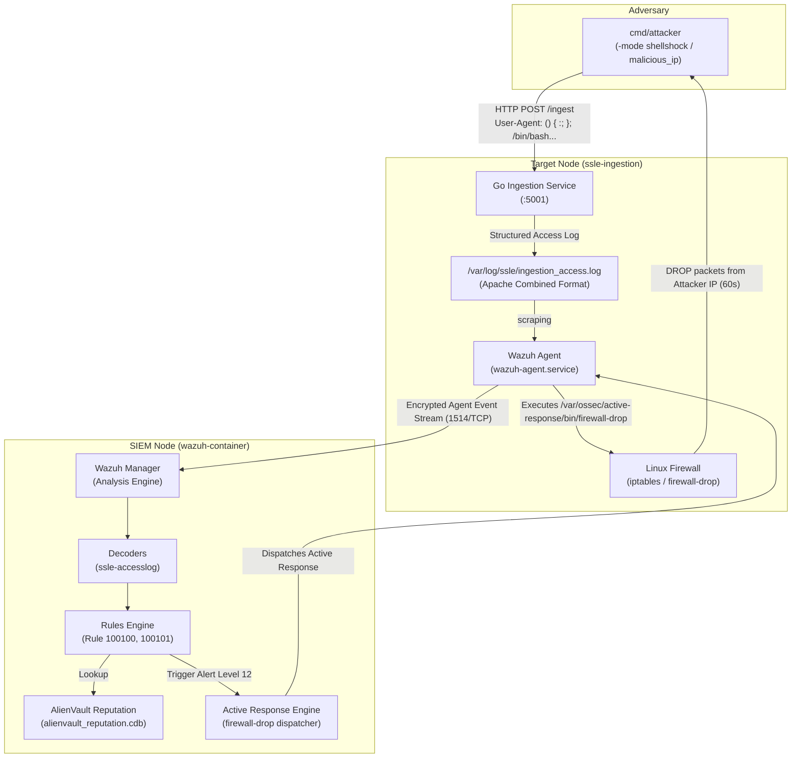

# SSLE Practical Guide 4: SIEM Integration (Wazuh), Threat Detection & Active Response

**Target System:** SOA Microservices (SSLE Project 1)  
**Security Focus:** Threat Detection, SIEM Log Analysis, Shellshock (CVE-2014-6271) Exploit Mitigation, AlienVault IP Reputation, and Automated Active Response (`firewall-drop`).  
**Environment:** Linux Incus Containers (Debian Trixie & Ubuntu 22.04), Kali VM.

---

## 1. Executive Summary & Threat Model

In modern large-scale distributed architectures, runtime application defenses must be coupled with centralized Security Information and Event Management (SIEM). This practical guide implements the end-to-end integration of **Wazuh SIEM** into the SSLE Service-Oriented Architecture, fulfilling the syllabus requirements for **Threat 1: Web Exploitation & Command Injection** and **Reputation Systems**.



---

## 2. Threat 1 Analysis: Shellshock (CVE-2014-6271) & IP Reputation

### 2.1 The Vulnerability
* **CVE-2014-6271 (Shellshock):** A critical vulnerability in GNU Bash that allows trailing commands following function definitions (`() { :; }; <command>`) in environment variables to be evaluated upon subshell invocation.
* **Attack Vector against SOA Gateway:**
  HTTP gateways and reverse proxies frequently export request headers (notably `User-Agent`, `Referer`, and query strings) as environment variables to CGI scripts or downstream process forks.
  An adversary sends an exploit payload within the `User-Agent` header:
  ```http
  POST /ingest HTTP/1.1
  Host: ssle-ingestion.incus:5001
  User-Agent: () { :; }; /bin/bash -c "echo VULNERABLE > /tmp/shellshock_pwn"
  Content-Type: application/json

  {"device_id":"exploiter","temperature":22.0}
  ```

### 2.2 Threat Intelligence: AlienVault IP Reputation
* Malicious botnets and command-and-control (C2) hosts are tracked via threat intelligence feeds.
* Guide 4 integrates the **AlienVault OTX IP Reputation list**, compiled into high-performance Wazuh Constant Database (CDB) format.
* Any HTTP request originating from a listed IP immediately triggers rule `100101` and automated active response.

---

## 3. SIEM Log Architecture & Decoders

### 3.1 Structured Access Logging in Go Microservices
The Go Ingestion Service (`cmd/ingestion/main.go`) includes an access logging middleware that outputs Apache Combined Log Format to `/var/log/ssle/ingestion_access.log`:

```
<client_ip> - - [<timestamp>] "<method> <uri> <protocol>" <status_code> <bytes_sent> "<referer>" "<user_agent>"
```

*Example Logged Shellshock Attack:*
```text
10.0.4.80 - - [11/Nov/2026:14:30:15 +0000] "POST /ingest HTTP/1.1" 403 76 "-" "() { :; }; /bin/bash -c 'id'"
```

### 3.2 Wazuh Custom Decoder (`monitoring/wazuh/decoders/local_decoder.xml`)
Extracts telemetry and security fields from the log stream:
```xml
<decoder name="ssle-accesslog">
  <type>web-log</type>
  <prematch>^\S+ - - \[\S+ \S+\] "\S+ </prematch>
</decoder>

<decoder name="ssle-accesslog-fields">
  <parent>ssle-accesslog</parent>
  <regex>^(\S+) - - \[(\S+) \S+\] "(\S+) (\S+) (\S+)" (\d+) (\d+) "(\S*)" "(.*)"</regex>
  <order>srcip, date, action, url, protocol, id, bytes, referer, user_agent</order>
</decoder>
```

---

## 4. Wazuh Detection Rules & Active Response

### 4.1 Custom Rules (`monitoring/wazuh/rules/local_rules.xml`)

| Rule ID | Severity Level | Target Threat | Detection Logic | MITRE ATT&CK |
| :--- | :--- | :--- | :--- | :--- |
| **`100100`** | **12 (Critical)** | Shellshock (CVE-2014-6271) | Regex matching `\(\)\s*\{\s*:;\s*\};` in HTTP request stream | T1059, T1190 |
| **`100101`** | **10 (High)** | AlienVault Blacklisted IP | Match `srcip` against `etc/lists/alienvault_reputation.cdb` | T1071, T1590 |
| **`100102`** | **8 (Medium)** | Volumetric HTTP Flood | $>25$ requests within 5 seconds from identical source IP | T1498 |
| **`100103`** | **9 (High)** | Unauthorized Registry Hijack | Blocked `DELETE /register/` attempts resulting in 403 Forbidden | T1565 |

### 4.2 Automated Active Response (`firewall-drop`)
Configured in `monitoring/wazuh/ossec.conf`:

```xml
<command>
  <name>firewall-drop</name>
  <executable>firewall-drop</executable>
  <timeout_allowed>yes</timeout_allowed>
</command>

<active-response>
  <command>firewall-drop</command>
  <location>local</location>
  <rules_id>100100, 100101</rules_id>
  <timeout>60</timeout>
</active-response>
```

When rule `100100` or `100101` fires:
1. Wazuh Manager analyzes the event and detects the critical attack pattern.
2. Manager sends an active response command to the agent running on `ssle-ingestion`.
3. The agent executes `/var/ossec/active-response/bin/firewall-drop add - <attacker_ip>`.
4. `iptables` rule `DROP src <attacker_ip>` is inserted into the container firewall.
5. All subsequent packets from the attacker are dropped at the kernel network stack.
6. After **60 seconds**, the active response script automatically flushes the block rule (`firewall-drop delete`), restoring standard traffic policy.

---

## 5. FCAPS Security & Fault Management Mapping

The integration strictly models the **5-stage FCAPS cycle**:

1. **Detecting:**
   - Go application middleware detects anomalous syntax in request headers.
   - Prometheus reports latency and request anomalies.
   - Wazuh agent tails `/var/log/ssle/ingestion_access.log` in real time.
2. **Diagnosing & Isolating:**
   - Wazuh Manager decodes the `srcip`, `user_agent`, and HTTP URI.
   - Rule `100100` identifies the exact exploit signature: Shellshock CVE-2014-6271.
   - Service Registry (`GET /services/locate/<id>`) maps the victim container and physical host.
3. **Correlating:**
   - Correlates the application layer HTTP 403 alert with Prometheus exporter spikes and threat intel CDB entries.
4. **Resolution / Mitigation:**
   - **Application Layer:** Go Ingestion Service denies request with HTTP 403 Forbidden.
   - **OS / Network Layer:** Wazuh Active Response applies `firewall-drop` via `iptables` for 60 seconds.
5. **Post-Mortem:**
   - Wazuh alerts are logged in `/var/ossec/logs/alerts/alerts.json` and visible on the Wazuh Dashboard.
   - Post-incident forensic logs show exact attacker IP, timestamp, payload, and block duration.

---

## 6. Verification and Deployment Instructions

### 6.1 Deploy Wazuh SIEM Manager (Incus)
```bash
# 1. Deploy Wazuh Manager in Incus container
./monitoring/wazuh/deploy_wazuh.sh
```

### 6.2 Deploy Wazuh Agent to Ingestion Service
```bash
# Get Wazuh Manager IP
WAZUH_IP=$(incus list wazuh-container --format csv -c 4 | awk '{print $1}')

# Install agent on ssle-ingestion
./monitoring/wazuh/install_agent.sh "$WAZUH_IP" ssle-ingestion
```

### 6.3 Run Attack Demonstrations (`cmd/attacker`)
```bash
# 1. Shellshock Exploit Simulation
./bin/attacker -target http://localhost:5001 -mode shellshock -concurrency 1 -duration 5

# 2. AlienVault Blacklisted IP Simulation
./bin/attacker -target http://localhost:5001 -mode malicious_ip -concurrency 1 -duration 5
```

### 6.4 Inspect Active Response Logs on Ingestion Node
```bash
# View active response firewall-drop actions inside container
incus exec ssle-ingestion -- cat /var/ossec/logs/active-responses.log

# Inspect active iptables drop rules
incus exec ssle-ingestion -- iptables -L -n -v
```

### 6.5 Automated Test Suite
To validate all components without requiring manual Incus containers:
```bash
./test_runner.sh
```
*(Runs Phase 6.5 & 6.6 verifying Shellshock HTTP 403 rejection, structured Apache access log formatting, and AlienVault CDB compilation).*
