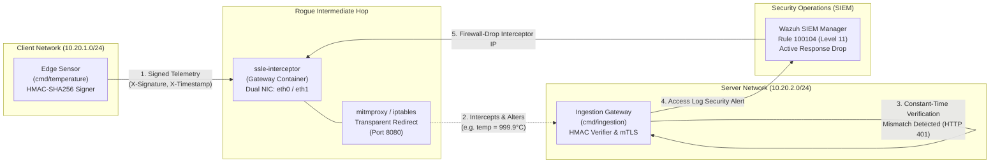

# SSLE Practical Guide 5: Route & Signals Hijacking / Man-in-the-Middle (MitM) Prevention

**Target System:** SOA Microservices (SSLE Project 1)  
**Security Focus:** Threat 3 — Route and Signals Hijacking, Network Interception (MitM), Payload Tampering, Cryptographic Authentication (HMAC-SHA256, TLS/mTLS), Replay Protection, and Wazuh SIEM Correlation.  
**Environment:** Linux Incus Containers (Dual-Subnet Bridge Topology), Ubuntu/Debian, mitmproxy.

---

## 1. Executive Summary & Threat Model

In distributed edge computing and sensor networks, telemetry data traverses untrusted intermediate networks before reaching ingestion gateways. **Threat 3: Route and signals hijacking** represents an active adversarial condition where an attacker positioned between edge sensors and central gateways intercepts, analyzes, alters, or replays telemetry traffic in transit.



---

## 2. Incus Dual-Subnet Interception Lab Topology

To accurately reproduce network-level interception without relying on local ARP poisoning, we architect a dual-subnet isolated routing environment in Incus:

| Component | Subnet / Interface | IP Address | Purpose |
| :--- | :--- | :--- | :--- |
| `ssle-net-client` | Client Bridge (`10.20.1.0/24`) | `10.20.1.1` (Gateway) | Isolated subnet for client edge sensors |
| `ssle-net-server` | Server Bridge (`10.20.2.0/24`) | `10.20.2.1` (Gateway) | Isolated subnet for ingestion & backend |
| `ssle-interceptor` | Dual-Homed Gateway (`eth0`, `eth1`) | `10.20.1.1` & `10.20.2.1` | Router performing transparent packet diversion |
| `ssle-sensor` | Client Subnet (`eth0`) | `10.20.1.50` | Simulates telemetry generator |
| `ssle-ingestion` | Server Subnet (`eth0`) | `10.20.2.10` | Central gateway receiving measurements |

### Automated Provisioning Script
The harness is fully automated via `scripts/deploy_mitm_topology.sh`:
```bash
./scripts/deploy_mitm_topology.sh
```

### Interceptor Redirection Rules
On `ssle-interceptor`, kernel IP forwarding is enabled and transparent TCP redirection intercepts inbound port 8080 traffic:
```bash
sysctl -w net.ipv4.ip_forward=1
iptables -t nat -A PREROUTING -p tcp --dport 8080 -j REDIRECT --to-ports 8080
mitmproxy --mode transparent --listen-port 8080
```

---

## 3. Threat Analysis & Vulnerability Walkthrough

### 3.1 Plaintext Telemetry Tampering (Without Defense)
When telemetry is transmitted over unauthenticated plaintext HTTP:
1. `cmd/temperature` transmits `{"device_id":"sensor-01","temperature":21.5}`.
2. `mitmproxy` intercepts the request in flight and rewrites the JSON body to `{"device_id":"sensor-01","temperature":999.9}`.
3. Central ingestion accepts the modified payload, passing bogus critical alerts to backend consumers.

### 3.2 Replay Attacks
Even if data is not modified, an attacker recording network packets can re-transmit historic readings indefinitely to desynchronize operational awareness.

---

## 4. Cryptographic Prevention & Mitigation Architecture

Our defense strategy implements **Defense-in-Depth** across Application (L7) and Transport (L4) layers:

### 4.1 Application-Layer: End-to-End Cryptographic Signing (HMAC-SHA256)
Implemented in [`internal/function/crypto.go`](file:///home/i/Desktop/Pedro/Universidade/4-1/SSLE/proj1/internal/function/crypto.go):

1. **Deterministic Canonical Formatting:**
   The signature is computed over both the timestamp string and the raw request body:
   $$\text{MAC} = \text{HMAC-SHA256}(K_{secret}, \text{timestamp} \mathbin{\Vert} \text{"."} \mathbin{\Vert} \text{body})$$

2. **Replay Window Protection (Drift Tolerance):**
   The server extracts `X-Signature-Timestamp` and computes:
   $$\Delta t = |t_{server} - t_{client}|$$
   If $\Delta t > \text{MAX\_TIMESTAMP\_DRIFT\_SECS}$ (default 10s), the request is rejected with `HTTP 401 Unauthorized` before signature computation.

3. **Constant-Time Verification:**
   To prevent timing side-channel attacks, signatures are compared using `crypto/hmac.Equal()`:
   ```go
   if !hmac.Equal(providedBytes, expectedBytes) {
       return false, "signature mismatch: payload modified in transit"
   }
   ```

4. **Integration in Microservices:**
   - [`cmd/temperature/main.go`](file:///home/i/Desktop/Pedro/Universidade/4-1/SSLE/proj1/cmd/temperature/main.go): Signs telemetry when `HMAC_SECRET_KEY` is configured.
   - [`cmd/ingestion/main.go`](file:///home/i/Desktop/Pedro/Universidade/4-1/SSLE/proj1/cmd/ingestion/main.go): Enforces verification when `ENABLE_HMAC_VERIFICATION=true`.

### 4.2 Transport-Layer: TLS & Mutual TLS (mTLS)
Automated by [`scripts/generate_certs.sh`](file:///home/i/Desktop/Pedro/Universidade/4-1/SSLE/proj1/scripts/generate_certs.sh):
- **Root CA:** Generates self-signed 4096-bit Certificate Authority (`ca.crt`).
- **Server Certificate:** Contains Subject Alternative Names (`DNS:ssle-ingestion.local`, `IP:127.0.0.1`, `IP:10.20.2.10`).
- **Client Certificate:** Provides cryptographic identity for edge sensors.
- **Rogue CA Emulation:** Proves that an untrusted proxy (`rogue_ca.crt`) fails client certificate validation (`x509: certificate signed by unknown authority`).

---

## 5. Wazuh SIEM Detection & Active Response

When an adversary tampers with packets in transit:
1. `cmd/ingestion` rejects the request, returning `HTTP 401 Unauthorized`.
2. Structured Apache Combined access log records:
   ```
   10.20.1.50 - - [11/Nov/2026:17:00:00 +0000] "POST /ingest HTTP/1.1" 401 98 "-" "SSLE-Attacker/1.0"
   ```
3. Wazuh Manager evaluates custom detection rule [`100104`](file:///home/i/Desktop/Pedro/Universidade/4-1/SSLE/proj1/monitoring/wazuh/rules/local_rules.xml#L54-L63):
   ```xml
   <rule id="100104" level="11">
     <if_group>web|access_log</if_group>
     <match>POST /ingest</match>
     <id>401</id>
     <description>SSLE SIEM Alert: Route/Signals Hijacking (MitM) or Cryptographic Signature Tampering detected</description>
     <mitre>
       <id>T1557</id>
       <id>T1565</id>
     </mitre>
     <group>mitm,tampering,integrity</group>
   </rule>
   ```
4. **Active Response:** Wazuh triggers `firewall-drop` to isolate the offending gateway or interceptor IP for 60 seconds.

---

## 6. Verification & Test Suite

The MitM defenses are verified via both Go unit/integration tests and the automated test runner:

```bash
# 1. Run Unit & Integration Tests (100% Pass)
go test -v ./tests/... -run TestHMACPayloadSigningAndTamperDefense

# 2. Run Comprehensive Multi-Service Test Runner
./test_runner.sh
```

### Verified Test Matrix
| Scenario | Request Signature | Timestamp | Body Integrity | Expected HTTP Status |
| :--- | :--- | :--- | :--- | :--- |
| **Authentic Request** | Valid HMAC-SHA256 | Current ($< 10s$) | Untampered | **200 OK** |
| **In-Flight Tampering** | Valid for original | Current | Modified ($999.9^\circ C$) | **401 Unauthorized** |
| **Replay Attack** | Valid for original | Stale ($> 60s$) | Untampered | **401 Unauthorized** |
| **Missing Signature** | None | None | Normal JSON | **401 Unauthorized** |
| **Tampered Timestamp**| Mismatched | Modified | Untampered | **401 Unauthorized** |
EOF