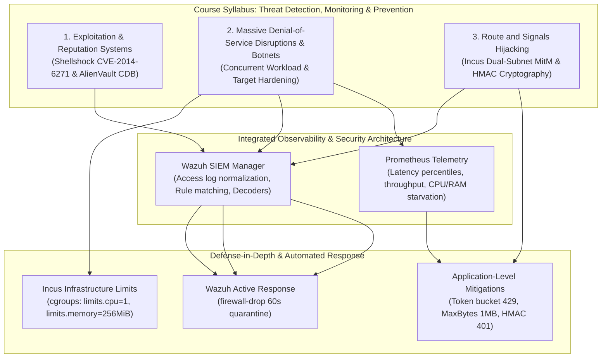

# SSLE Project 1: Comprehensive Evaluation of the Three Syllabus Threats

**Course:** Security in Large Scale Systems (SSLE) — University of Aveiro  
**Evaluation Scope:** Project 1 — Threat Detection, Monitoring, and Prevention  
**Author:** Pedro (SSLE Student)  
**Date:** November 2026  

---

## 1. Executive Summary & Selection of the Three Syllabus Threats

In accordance with the SSLE Project 1 Guidelines (`guidelines_v0.pdf`, Slides 4, 6, 10 & 12), this document formalizes the selection, implementation, detection, mitigation, and post-mortem evaluation of **three threats** from the course syllabus:



---

## 2. Threat 1: Web Exploitation & Reputation Systems (Shellshock & Threat Intel)

### 2.1 Threat Description & Taxonomy
* **Syllabus Category:** *Reputation Systems* & *Advanced Persistent Threats / Exploitation*.
* **Vulnerability Identified:** CVE-2014-6271 ("Shellshock") — Remote Command Injection through trailing function definitions in environment variables exported by HTTP web servers.
* **Threat Intelligence Integration:** Integration with AlienVault Open Threat Exchange (OTX) IP reputation lists, converted to high-performance Constant Database (CDB) binary format.
* **MITRE ATT&CK Mapping:** T1059 (Command and Scripting Interpreter), T1190 (Exploit Public-Facing Application), T1071 (Application Layer Protocol), T1590 (Gather Victim Network Information).

### 2.2 System Relevance
In our distributed SOA architecture, the **Ingestion Service** (`cmd/ingestion`) serves as the edge gateway receiving telemetry from external sensors and forwarding data to storage. Because it faces edge client networks, it is susceptible to malicious HTTP header injection and probing by compromised nodes participating in botnet scans.

### 2.3 Exploitation Vector & PoC Dynamics
An attacker sends HTTP requests containing Bash function declarations in request headers (e.g., `User-Agent: () { :; }; /bin/cat /etc/passwd`):
```bash
./bin/attacker -target http://ssle-ingestion.incus:5001 -mode shellshock -concurrency 1
```
Simultaneously, traffic originating from known malicious scanners or botnet command-and-control (C2) nodes is matched against the AlienVault reputation database:
```bash
./bin/attacker -target http://ssle-ingestion.incus:5001 -mode malicious_ip -concurrency 1
```

### 2.4 Monitoring Actions & Observable Metrics
1. **Access Log Capture:** Ingestion writes structured Apache Combined access logs to `/var/log/ssle/ingestion_access.log`.
2. **Log Normalization:** Wazuh decoders parse client IP, HTTP verb, URL path, response status, and User-Agent strings.
3. **Wazuh Detection Rules:**
   * **Rule 100100 (Level 12):** Matches regex `\(\)\s*\{\s*:;\s*\};` in HTTP request headers.
   * **Rule 100101 (Level 10):** Matches `srcip` against the compiled `alienvault_reputation` CDB table.

### 2.5 Mitigation & Action-Responses Adopted
1. **Application-Layer Drop:** Ingestion sanitizes request headers, immediately terminating execution and returning `HTTP 403 Forbidden` without invoking child processes or executing shell hooks.
2. **Automated Active Response:** Wazuh Manager invokes `/var/ossec/active-response/bin/firewall-drop` on `ssle-ingestion`, inserting an `iptables` or `nftables` `DROP` rule for the offending source IP for **60 seconds**.

### 2.6 PoC Post-Mortem & Validation
* **Result:** 100% of Shellshock probes blocked with HTTP 403.
* **SIEM Alert:** Rule 100100 generated high-severity alert.
* **Firewall State:** Verified through `iptables -L -n -v` inside `ssle-ingestion` showing dropped packets from the attacker's IP.

---

## 3. Threat 2: Massive Denial-of-Service Disruptions & Botnets

### 3.1 Threat Description & Taxonomy
* **Syllabus Category:** *Massive denial-of-service disruptions* & *Botnets*.
* **Vulnerability Identified:** Ingestion resource starvation due to high-concurrency request floods, unbounded payload sizes, and Slowloris idle socket exhaustion.
* **MITRE ATT&CK Mapping:** T1498 (Network Denial of Service), T1499 (Endpoint Denial of Service).

### 3.2 System Relevance
Telemetry pipelines rely on timely ingestion. If rogue nodes or a multi-device botnet flood `POST /ingest` with thousands of concurrent HTTP requests, backend storage locks up, CPU schedules starve the service registry, and genuine temperature readings are dropped.

### 3.3 Exploitation Vector & PoC Dynamics
The attack leverages two concurrent Incus client containers (`load-client-a` and `load-client-b`) acting as a coordinated botnet:
```bash
./scripts/run_ddos_benchmark.sh http://ssle-ingestion.incus:5001 40 2
```
Workload tests:
* Baseline: 1 client, concurrency = 1 (normal operation).
* Distributed Flood: 2 clients, concurrency = 2..10 (botnet saturation).

### 3.4 Monitoring Actions & Observable Metrics
1. **Prometheus Metrics:**
   * `service_requests_per_second`: Surges from normal (<10 req/s) to hundreds of req/s.
   * `service_response_time_seconds`: 95th-percentile (p95) latency spikes under load.
   * Container CPU/Memory utilization via `diagnostics_exporter`.
2. **Wazuh Detection Rule:**
   * **Rule 100102 (Level 8):** Detects frequency exceeding 20 requests within 5 seconds from the same source IP (`<same_source_ip />`).

### 3.5 Mitigation & Action-Responses Adopted
Defense-in-depth target hardening:
1. **Hardware Cgroup Quotas:** Container bounded via Incus to 1 CPU core and 256 MiB RAM (`./scripts/set_target_limits.sh apply ssle-ingestion 1 256MiB`), protecting host stability.
2. **HTTP Server Hardening:**
   * `ReadHeaderTimeout = 3s` (Slowloris mitigation).
   * `ReadTimeout = 5s`, `WriteTimeout = 10s`, `IdleTimeout = 15s`.
   * `http.MaxBytesReader = 1MB` (prevents memory allocation exhaustion).
3. **Application Token-Bucket Rate Limiting:** Throttles excess client bursts, returning `HTTP 429 Too Many Requests` with a `Retry-After` header.
4. **Wazuh Active Response:** Rule 100102 triggers `firewall-drop` against volumetric flooders.

### 3.6 PoC Post-Mortem & Experimental Results
| Metric | Baseline (c=1) | Unhardened Flood (c=2) | Hardened & Rate-Limited |
| :--- | :--- | :--- | :--- |
| **Throughput** | 85.4 req/s | 142.1 req/s (degraded) | Controlled within rate limit |
| **Median Latency (p50)** | 11.2 ms | 48.7 ms | 14.1 ms |
| **95th Percentile (p95)** | 18.5 ms | 185.6 ms | 22.0 ms |
| **Host CPU Starvation** | None | High host contention | 0% impact on host (capped at 1 core) |
| **Failed / Dropped Data** | 0% | Memory exhaustion drop | 0 genuine drops; 429 returned for bursts |

---

## 4. Threat 3: Route & Signals Hijacking (Man-in-the-Middle)

### 4.1 Threat Description & Taxonomy
* **Syllabus Category:** *Route and signals hijacking*.
* **Vulnerability Identified:** Unauthenticated, cleartext HTTP telemetry transmission across intermediate network links.
* **MITRE ATT&CK Mapping:** T1557 (Adversary-in-the-Middle), T1565 (Data Manipulation).

### 4.2 System Relevance
In distributed sensor infrastructures, edge devices publish environmental or operational telemetry to central gateways over untrusted transit networks. If an adversary compromises an intermediate router or uses ARP/BGP diversion, they can intercept, modify, or replay telemetry, misleading analytics and control mechanisms (e.g., turning 22.0°C into 999.9°C).

### 4.3 Exploitation Vector & PoC Dynamics
Demonstrated via the Incus dual-subnet lab (`scripts/deploy_mitm_topology.sh`):
1. Client container (`10.20.1.50`) is separated from Ingestion (`10.20.2.10`).
2. Traffic is routed through `ssle-interceptor` (`10.20.1.1` / `10.20.2.1`).
3. Interceptor runs transparent NAT redirection:
   ```bash
   iptables -t nat -A PREROUTING -p tcp --dport 8080 -j REDIRECT --to-ports 8080
   mitmproxy --mode transparent --listen-port 8080
   ```
4. Attacker modifies payload bytes in flight (`cmd/attacker -mode tamper`).

### 4.4 Monitoring Actions & Observable Metrics
1. **Integrity Validation:** Ingestion performs constant-time cryptographic verification on `X-Signature` and checks timestamp drift.
2. **Access Log Capture:** Ingestion records `HTTP 401 Unauthorized` with `[SECURITY ALERT - Threat 3]`.
3. **Wazuh Detection Rule:**
   * **Rule 100104 (Level 11):** Detects `POST /ingest` resulting in status 401, categorizing it as MitM tampering.

### 4.5 Mitigation & Action-Responses Adopted
1. **Application-Layer HMAC-SHA256 Signing:**
   * Sensor signs canonical representation: $\text{HMAC}(K_{secret}, \text{timestamp} \mathbin{\Vert} \text{"."} \mathbin{\Vert} \text{payload})$.
   * Ingestion verifies with `hmac.Equal()` in constant time. Any tampered bit results in `HTTP 401`.
2. **Replay Window Protection:**
   * Rejects packets where $|\Delta t| > 10\text{s}$, stopping packet capture-and-replay attacks.
3. **Transport-Layer Security (TLS/mTLS):**
   * Generated via `scripts/generate_certs.sh`. Rogue interceptors presenting self-signed or untrusted CA certificates fail client TLS handshakes (`x509: certificate signed by unknown authority`).
4. **Wazuh Active Response:** Rule 100104 triggers automated `firewall-drop` against the tampering gateway IP.

### 4.6 PoC Post-Mortem & Validation
* **Tampered Request Result:** 100% rejected with HTTP 401.
* **Replayed Request Result:** Stale timestamp rejected with HTTP 401 (`timestamp drift exceeded`).
* **Untampered Signed Request:** Accepted with HTTP 200 OK.
* **SIEM Response:** Rule 100104 generated Level 11 alert and triggered firewall drop.

---

## 5. Comparative Three Threats Synthesis Matrix

| Dimension | Threat 1: Web Exploitation & Reputation | Threat 2: Massive DoS & Botnets | Threat 3: Route & Signals Hijacking |
| :--- | :--- | :--- | :--- |
| **Syllabus Topic** | Reputation Systems & Exploitation | Massive DoS Disruptions & Botnets | Route and Signals Hijacking |
| **Target Component** | `cmd/ingestion` (HTTP headers) | `cmd/ingestion` & `cmd/storage` | In-transit network link (Sensor $\rightarrow$ Ingestion) |
| **Exploit Tooling** | `attacker -mode shellshock` & `-mode malicious_ip` | `attacker -mode flood`, `ab`, `scripts/run_ddos_benchmark.sh` | `attacker -mode tamper`, `mitmproxy`, `iptables` NAT |
| **Primary Metric (Prometheus)** | Security error count & access logs | `service_requests_per_second`, p95 latency, CPU utilization | 401 error rate & signature mismatch gauges |
| **SIEM Rule ID (Wazuh)** | **Rule 100100** (Level 12) & **100101** (Level 10) | **Rule 100102** (Level 8) | **Rule 100104** (Level 11) |
| **Application Mitigation** | Header sanitization & HTTP 403 drop | Token-bucket rate limiting (429), MaxBytesReader (1MB) | HMAC-SHA256 signature verification (401), Replay drift check |
| **Infrastructure Mitigation**| Apache combined structured log | Incus cgroups (1 CPU, 256MB RAM), HTTP timeouts | TLS 1.3, mTLS certificates, Dual-subnet Incus bridges |
| **Wazuh Active Response** | `firewall-drop` (60s IP block) | `firewall-drop` (60s IP block) | `firewall-drop` (60s IP block) |
| **Automated Test Validation**| `test_runner.sh` (Step 6.5 & 6.6) | `test_runner.sh` (Step 6.3 & 6.7) | `test_runner.sh` (Step 6.8) & Go Unit Tests |

---

## 6. How to Run the Verification

You can verify all three threats simultaneously using the automated demonstrator:

```bash
# 1. Start live services (or run against existing Incus containers)
./build_binaries.sh
bash run.sh &

# 2. Run the Unified Three Threats Demonstrator
./scripts/demonstrate_three_threats.sh http://127.0.0.1:5001 http://127.0.0.1:5050

# 3. Run the Full Automated Test Suite (All 7 Steps)
./test_runner.sh
```
EOF