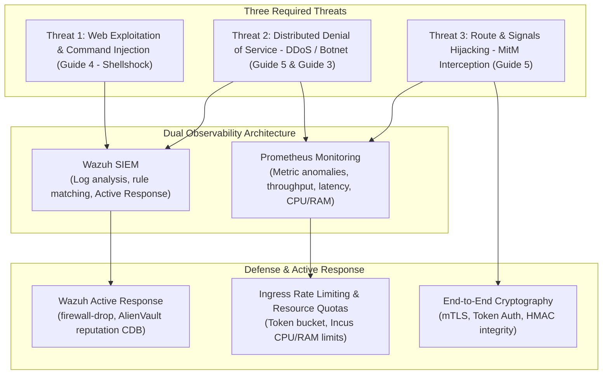

# SSLE Project 1: System Audit, Gap Analysis & Roadmap
**Document:** Project 1 Preparation Report  
**Target Project:** Threat Detection, Monitoring, and Prevention (Project 1 — Due Nov 22)  
**Author:** Antigravity (Pair Programming Assistant)  
**Date:** November 11, 2026  

---

## 1. Executive Summary

This report analyzes the current state of **`incremental_system`** against:
1. **The Official Project 1 Guidelines** ([`guidelines_v0.pdf`](file:///home/i/Desktop/Pedro/Universidade/4-1/SSLE/p/guidelines_v0.pdf)).
2. **Practical Guide 4: SIEM — Wazuh & Shellshock** ([`004.pdf`](file:///home/i/Desktop/Pedro/Universidade/4-1/SSLE/p/004.pdf)).
3. **Practical Guide 5: DDoS and Man-in-the-Middle (MitM)** ([`005.pdf`](file:///home/i/Desktop/Pedro/Universidade/4-1/SSLE/p/005.pdf)).

### Current Project Baseline
The current codebase has completed **Guides 1, 2, and 3**:
* A working 5-service SOA Go microservice pipeline (Registry, Ingestion, Storage, Analytics, Temperature).
* Full Prometheus monitoring written in Go (`cmd/health_exporter`, `cmd/diagnostics_exporter`, `cmd/pushgateway_publisher`).
* Attack-Defense Tree documentation and adversary tooling (`cmd/attacker`).
* Defense countermeasures (Token-bucket rate limiting, input validation bounds, device blocklisting, admin tokens).
* An isolated, idempotent automated test suite (`test_runner.sh`).

### Core Conclusion
While the foundational microservice architecture and Prometheus monitoring are solid, the project is missing the core **SIEM integration (Wazuh)**, the **three formalized threat scenarios** required by the syllabus, the **scalable hierarchical naming structure**, and the **FCAPS event correlation workflow**. Additionally, several Kubernetes assets represent unnecessary overhead for this Incus-centric course evaluation.

---

## 2. Inventory of "Over" (Excess / Misaligned Components)

The following components currently exist in `incremental_system` but represent excess or misaligned scope relative to Project 1 evaluation:

| Component | Files | Issue / Why It Is "Over" | Recommendation |
| :--- | :--- | :--- | :--- |
| **Kubernetes Deployment Scripts & Manifests** | • `deploy_k8s.sh`<br>• `cleanup_k8s.sh`<br>• `k8s/ssle-k8s.yaml`<br>• `docker/Dockerfile`<br>• `docker/Dockerfile.fast` | • The course syllabus, Project 1 guidelines, and Guides 2–5 exclusively test against **Incus system containers** running on the Kali VM.<br>• Running a local K3s cluster inside Incus nested containers causes severe VM kernel panics and memory overcommit contention (as noted in `README.md`).<br>• The grading demo is evaluated via Incus CLI commands (`incus list`, `incus exec`, `incus config`). | **Retain as reference in `k8s/` or archive**, but exclude from the primary demo and grading pipeline. Do not invest further effort in K8s manifests for Project 1. |
| **Standalone Pushgateway Publisher** | • `cmd/pushgateway_publisher/main.go` | • Implemented specifically to answer the theoretical challenge in Guide 3.<br>• For long-running services, pushgateway masks liveness failures. | Keep as a demonstration asset for Guide 3 challenge, but do not integrate into the primary production monitoring path. |
| **Monolithic Local Run Script** | • `run.sh` | • Starts all microservices on localhost in the background without network isolation. | Keep for quick local compilation checks, but rely on `deploy_incus.sh` for the official VM demonstration. |

---

## 3. Gap Analysis: What is Missing for Project 1 & Guides 4–5

### Gap 1: Scalable Hierarchical Naming & Logical/Physical Location (Project Requirement) — **STATUS: COMPLETED [x]**
* **What Guidelines Mandate:**
  * Identification and registration of elements in a scalable way.
  * Clear distinction of where elements reside in physical terms (host machine) vs. logical terms (container/namespace).
  * Geographic location and delegation of responsibilities.
  * Ability to monitor elements by location, optimizing consumed bandwidth (bonus).
  * Rapid localization of incident sources.
* **Implemented Solution:**
  * **Hierarchical Service Location Model (`internal/models/service.go`):**
    Introduced `models.ServiceLocation` and Fully Qualified Service Names (FQSN) following the canonical taxonomy:
    ```
    <region>.<zone>.<physical_host>.<logical_env>.<instance_id>.<kind>
    Example: pt-aveiro.lab-ssle.kali-vm.incus:ssle-ingestion.ingest-01.ingestion
    ```
    Provides explicit segregation of physical hardware (`physical_host`), logical isolation container (`logical_env`), availability zone (`zone`), and geographic region (`region`).
  * **Locality-Aware Service Discovery & Bandwidth Optimization (`internal/function/discover.go`):**
    Implemented `DiscoverLocally()` which prioritizes intra-zone endpoints first (zero cross-zone latency/bandwidth cost), expands to regional peers, and falls back to global services only if necessary.
  * **Hierarchical Registry Query Endpoints (`cmd/registry/main.go`):**
    Supported fine-grained querying across all dimensions:
    `GET /services?region=...&zone=...&physical_host=...&logical_env=...&kind=...&prefix=...`
    and `GET /services/{kind}?region=...&zone=...`.
  * **Rapid Incident Localization Endpoint (`GET /services/locate/{query}`):**
    Provides instant mapping from an incident symptom, service ID, FQSN, or endpoint IP to the exact physical machine, logical container, administrative domain, and remediation command (`incus exec <container> -- ...`).
  * **Location-Aware Prometheus Monitoring (`cmd/health_exporter`):**
    Exposes `region`, `zone`, `physical_host`, and `logical_env` as Prometheus metric labels on `service_health` and `service_response_time_seconds`, allowing location-based telemetry aggregation and regional monitoring delegation.
  * **Comprehensive Automated Validation:**
    Added unit tests in `internal/function/function_test.go`, integration tests in `tests/unit_and_integration_test.go`, and end-to-end assertions in `test_runner.sh` (Step 5.1b).

---

### Gap 2: Guide 4 — SIEM (Wazuh) Integration & Active Response — **STATUS: COMPLETED [x]**
* **What Guidelines & Guide 4 Mandate:**
  * Wazuh server deployment in Incus (`images:ubuntu/22.04 wazuh-container`).
  * Wazuh agents installed on target/victim nodes (`apache-container` or SOA nodes).
  * Real-time log collection into Wazuh via `/var/ossec/etc/ossec.conf` (`<localfile>`).
  * Threat detection: **Shellshock (CVE-2014-6271)** or malicious HTTP injection patterns (`User-Agent: () { :; }; ...`).
  * **Wazuh Active Response (`<active-response>`):** Automated firewall blocking (`firewall-drop`) for 60 seconds triggered by custom rule (`100100`) backed by the AlienVault reputation CDB list.
* **Implemented Solution:**
  * **Automated Wazuh Incus Deployment (`monitoring/wazuh/deploy_wazuh.sh` & `cleanup_wazuh.sh`):**
    Provisions `wazuh-container` (Ubuntu 22.04) with resource constraints (`limits.cpu=2`, `limits.memory=2GiB`), installs Wazuh Manager, copies custom rules, decoders, AlienVault reputation CDB list, configures Active Response, and compiles CDB lists via `wazuh-makelists`.
  * **Automated Agent Provisioning (`monitoring/wazuh/install_agent.sh`):**
    Installs `wazuh-agent` on `ssle-ingestion`, points to Manager IP, and configures `<localfile>` log scraping on `/var/log/ssle/ingestion_access.log`.
  * **Structured Access Logging Middleware (`cmd/ingestion/main.go`):**
    Implements Apache Combined Log Format outputting to `/var/log/ssle/ingestion_access.log` (with graceful fallback). Captures client IP, HTTP method, URI, protocol, status code, bytes sent, and User-Agent.
  * **Application-Level Shellshock Sanitization & Defense:**
    Detects Shellshock function declaration signatures (`() {`) in request headers and drops malicious payloads with `HTTP 403 Forbidden`, while preserving the log signature for SIEM correlation.
  * **Custom Wazuh Rules & Decoders (`monitoring/wazuh/rules/` & `decoders/`):**
    * **Rule 100100 (Level 12):** Shellshock (CVE-2014-6271) command injection detection via PCRE regex `\(\)\s*\{\s*:;\s*\};`.
    * **Rule 100101 (Level 10):** Threat intelligence detection matching `srcip` against AlienVault IP reputation CDB list (`etc/lists/alienvault_reputation`).
    * **Rule 100102 (Level 8):** Volumetric HTTP flood detection.
    * **Rule 100103 (Level 9):** Unauthorized registry deletion attempt alerts.
  * **Active Response (`firewall-drop`):**
    Configured in `monitoring/wazuh/ossec.conf` to trigger `/var/ossec/active-response/bin/firewall-drop` for 60 seconds against attacker source IPs triggering rules 100100 or 100101.
  * **Adversary Tooling Update (`cmd/attacker/main.go`):**
    Added `-mode shellshock` and `-mode malicious_ip` flags to simulate real-world attacks.
  * **Comprehensive Documentation & FCAPS Workflow (`docs/guide4_siem_wazuh.md`):**
    Complete guide mapping detection, diagnosis, correlation, remediation, and post-mortem.
  * **Automated Test Validation (`test_runner.sh` & `tests/`):**
    Added unit test `TestWazuhSIEMLoggingAndShellshockDefense` and automated pipeline steps 6.5 & 6.6 verifying exploit rejection, log formatting, and CDB parsing.

---

### Gap 3: Guide 5 — Distributed Denial of Service (DDoS) & Target Hardening — **STATUS: COMPLETED [x]**
* **What Guide 5 Mandates:**
  * Botnet traffic emulation using two concurrent lab client containers (`load-client-a`, `load-client-b`).
  * Standardized HTTP workload benchmarking using ApacheBench (`ab -n 40 -c 1` baseline vs. `ab -n 40 -c 2` concurrent).
  * System resource constraints applied at container level via Incus:
    ```bash
    incus config set <target> limits.cpu=1
    incus config set <target> limits.memory=256MiB
    ```
  * Correlating performance metrics under resource starvation: throughput (req/s), median latency, 95th-percentile (p95) latency, failed requests, and container CPU/memory exhaustion.
  * Demonstrating mitigation controls: rate limiting, upstream filtering, worker concurrency tuning.
* **Implemented Solution:**
  * **Automated Botnet Harness (`scripts/deploy_ddos_clients.sh` & `cleanup_ddos_clients.sh`):**
    Provisions two isolated Incus client containers (`load-client-a` and `load-client-b`), installs `apache2-utils` (`ab`), `curl`, and `jq`, and configures standard JSON telemetry payloads.
  * **Incus Container Resource Constraints (`scripts/set_target_limits.sh`):**
    Automates setting, querying, and resetting cgroup hardware limits (`limits.cpu=1`, `limits.memory=256MiB`) on `ssle-ingestion` to prevent host CPU starvation and unbounded container memory expansion.
  * **Automated Benchmark Runner & Worksheet Generator (`scripts/run_ddos_benchmark.sh`):**
    Orchestrates the 3-phase Guide 5 experiment: Baseline (1 client, c=1), Distributed DoS (2 concurrent clients, c=2..10), and Hardened runs. Automatically extracts throughput (req/s), median latency (p50), 95th percentile latency (p95), failed requests, and throttled counts, formatting the results in the required worksheet comparison table.
  * **HTTP Server Timeout & Payload Hardening (`cmd/ingestion/main.go`):**
    Replaced unbound default HTTP server with hardened `http.Server` featuring `ReadHeaderTimeout` (3s, Slowloris defense), `ReadTimeout` (5s), `WriteTimeout` (10s), `IdleTimeout` (15s), and `http.MaxBytesReader` (1MB payload cap).
  * **Enhanced Adversary Benchmarking (`cmd/attacker/main.go`):**
    Updated `attacker` with `-requests N` flag, `-mode benchmark`, and microsecond latency percentile calculation (min, mean, median/p50, p95, max) for standalone automated benchmarking in non-Incus/CI environments.
  * **Automated Test Validation (`test_runner.sh` & `tests/`):**
    Added unit test `TestDDoSTargetHardeningControls` (testing 1MB payload capping and rate-limiting) and test suite Step 6.7 executing the automated benchmark runner and asserting latency and throughput calculations.
  * **Comprehensive Guide 5 Report (`docs/guide5_ddos_and_hardening.md`):**
    Published full analysis documenting Threat 2 dynamics, target hardening layers, experimental worksheets, Prometheus/Wazuh correlation, and FCAPS fault management mapping.

---

### Gap 4: Guide 5 — Route & Signals Hijacking / Man-in-the-Middle (MitM)
* **What Guide 5 & Syllabus Mandate:**
  * Isolated network topology: Client and Target placed on separate private subnets with traffic forced through an Interceptor.
  * Interceptor configured with Linux IP forwarding (`net.ipv4.ip_forward=1`) and disabled ICMP redirects.
  * Transparent TCP redirection via `iptables` NAT PREROUTING:
    ```bash
    iptables -t nat -A PREROUTING -i "$CLIENT_IF" -s "$CLIENT_IP"/32 -d "$TARGET_IP"/32 -p tcp --dport 80 -j REDIRECT --to-ports 8080
    ```
  * Transparent proxying using `mitmproxy --mode transparent --listen-port 8080`.
  * Traffic interception verification: client sends requests without explicit proxy configuration (`curl --noproxy "*"`), interceptor inspects and logs payloads.
  * Optional HTTPS extension: showing TLS certificate validation failure on untrusted proxy vs. custom lab CA installation.
* **Current State:**
  * Completely unaddressed in `incremental_system`.
* **What is Needed:**
  1. An Incus network provisioning script creating dual isolated bridges (e.g. `ssle-net-client`, `ssle-net-server`) and routing container `ssle-interceptor`.
  2. Automated script to configure `iptables` redirection rules and start `mitmproxy`.
  3. Verification tests demonstrating transparent interception of sensor telemetry or API requests.
  4. Cryptographic mitigation (e.g., mTLS between microservices, HMAC payload signing) demonstrating how the SOA prevents eavesdropping or tampering even when a network interceptor is active.

---

### Gap 5: The "Three Threats" Selection for Project 1
Project 1 requires students to address **three threats** from the syllabus. Based on Guides 3, 4, and 5, the most coherent and fully supported triad is:



1. **Threat 1: Web Exploitation & Injection (Shellshock / Malicious Payloads — Guide 4)**
   * *Target:* Exposed HTTP gateway or Apache proxy.
   * *Detection:* Wazuh agent log parsing (`localfile`) + Rule `100100`.
   * *Mitigation:* Wazuh Active Response (`firewall-drop` for 60s) + AlienVault reputation database.
2. **Threat 2: Volumetric Denial-of-Service / Botnet (DDoS — Guide 5 & 3)**
   * *Target:* Ingestion Service (`POST /ingest`).
   * *Detection:* Prometheus request rate surges (`service_requests_per_second`), latency percentiles (`service_response_time_seconds`), and Incus CPU starvation.
   * *Mitigation:* Token-bucket rate limiting (`HTTP 429`), payload size capping, container resource isolation.
3. **Threat 3: Route & Signals Hijacking (Transparent MitM Interception — Guide 5)**
   * *Target:* Inter-service telemetry transmission.
   * *Detection:* Network anomaly detection, TLS validation mismatch, unauthenticated registry unregistration.
   * *Mitigation:* Mutual TLS (mTLS) / pre-shared authentication tokens (`X-Admin-Token`), preventing plain-text eavesdropping or tampering.

---

### Gap 6: Fault Management Workflow (FCAPS) & Event Correlation
* **What Guidelines Mandate:**
  * Must follow the 5-stage FCAPS cycle:
    1. **Detecting:** Immediate observation of an anomaly.
    2. **Diagnosing & Isolating:** Narrowing down affected service and host container.
    3. **Correlating:** Connecting metric symptoms (Prometheus CPU/latency spike) with log/security causes (Wazuh attack alerts).
    4. **Resolution / Mitigation:** Automated (Wazuh active-response firewall drop) and application-level (rate-limiting 429).
    5. **Post-Mortem:** Analysis of logs, attack traces, and recovery verification.
* **Current State:**
  * Prometheus and defensive code handle *detection* and *remediation*, but correlation between metric alarms and security events is currently manual and undocumented.

---

## 4. Required Adjustments to Existing Microservices

To integrate seamlessly with Wazuh, Incus multi-container networking, and hierarchical naming, the following adjustments to the Go services will be needed:

| Microservice | Location | Required Adjustment |
| :--- | :--- | :--- |
| **Registry** | `cmd/registry/main.go` | **[DONE]** Updated `models.Service` with location hierarchy fields (`Region`, `Zone`, `PhysicalHost`, `LogicalEnv`, `FQSN`). Added query filtering and rapid incident localization (`GET /services/locate/{id}`). |
| **Ingestion** | `cmd/ingestion/main.go` | **[DONE]** Output structured Apache Combined access logs to `/var/log/ssle/ingestion_access.log` for Wazuh agent scraping. Added application-level Shellshock detection and blocking. |
| **Temperature** | `cmd/temperature/main.go` | • Support registering with hierarchical name tags (e.g. `region="pt-north", zone="lab-01"`). |
| **Attacker** | `cmd/attacker/main.go` | **[DONE]** Added `-mode shellshock` for CVE-2014-6271 exploit testing and `-mode malicious_ip` for AlienVault CDB reputation testing. |
| **Deploy Scripts** | `deploy_incus.sh` | **[DONE]** Configured `/var/log/ssle` log directories and environment variables for Wazuh agent access on Incus containers. |

---

## 5. Proposed Phased Implementation Plan

```
[Phase 1: Architecture & Naming] ──> [Phase 2: Guide 4 (Wazuh & Shellshock)] ──> [Phase 3: Guide 5 (DDoS & MitM)] ──> [Phase 4: Test Suite & Report]
```

### Phase 1: Hierarchical Naming & Structured Logging
1. **[DONE]** Update `internal/models/service.go` with location hierarchy attributes and canonical FQSN.
2. **[DONE]** Update `cmd/registry` to index services hierarchically, enable zone/region querying, and add rapid incident localization.
3. **[DONE]** Add structured access logging (Apache Combined format) in `cmd/ingestion` and `cmd/registry` to enable Wazuh agent ingestion.

### Phase 2: Wazuh SIEM Deployment & Threat 1 (Guide 4) — **[COMPLETED]**
1. **[DONE]** Write `monitoring/wazuh/deploy_wazuh.sh` to spin up `wazuh-container` (manager + dashboard) in Incus.
2. **[DONE]** Install and configure `wazuh-agent` on the ingestion/gateway container (`monitoring/wazuh/install_agent.sh`).
3. **[DONE]** Configure Wazuh `<localfile>` log reading for the access logs (`monitoring/wazuh/ossec.conf`).
4. **[DONE]** Add Wazuh custom rule `100100` and AlienVault reputation CDB list (`monitoring/wazuh/rules/local_rules.xml` & `lists/`).
5. **[DONE]** Configure Wazuh `<active-response>` for `firewall-drop` (60s ban).
6. **[DONE]** Verify with Shellshock probe from `cmd/attacker` and automated CI tests in `test_runner.sh`.

### Phase 3: DDoS & Target Hardening — Threat 2 (Guide 5) — **[COMPLETED]**
1. **[DONE]** Write `scripts/deploy_ddos_clients.sh` and `cleanup_ddos_clients.sh` to launch and configure `load-client-a` and `load-client-b` in Incus.
2. **[DONE]** Automate container resource limits (`scripts/set_target_limits.sh` for `limits.cpu=1`, `limits.memory=256MiB`).
3. **[DONE]** Run baseline (1 client, c=1) vs. paired concurrent run (2 clients, c=2..10) via automated benchmark runner `scripts/run_ddos_benchmark.sh`.
4. **[DONE]** Record performance worksheet metrics (throughput, median, p95 latency, error count, and Prometheus correlation in `docs/guide5_ddos_and_hardening.md`).

### Phase 4: Route Hijacking & MitM — Threat 3 (Guide 5)
1. Write `scripts/deploy_mitm_topology.sh` to provision dual Incus subnets and an interceptor container.
2. Configure interceptor `iptables` PREROUTING redirect to `mitmproxy` (port 8080).
3. Demonstrate transparent interception of unencrypted HTTP traffic.
4. Implement and demonstrate mitigation: mutual TLS (mTLS) or cryptographic message signatures so intercepted traffic cannot be read or forged.

### Phase 5: CI Testing Infrastructure Update — **[COMPLETED]**
1. **[DONE]** Extended `test_runner.sh` to validate hierarchical registry queries, location matching, negative matching, and rapid incident localization.
2. **[DONE]** Added automated regression checks for Threat 1 (Shellshock exploit rejection and access log formatting) and Threat 2 (DDoS benchmarking and worksheet generation).
3. **[DONE]** Comprehensive happy and unhappy path test coverage: malformed payloads (400), payload capping (1MB), exact boundary checks (-50.0°C and 100.0°C), unauthorized access (403), non-existent endpoints (404), and database zero-reading handling.

### Phase 6: Project 1 Report Preparation (`docs/project1_report.md`)
Draft the final academic report following the required structure from `guidelines_v0.pdf`:
* Introduction
* State of the Art (SOA, SIEM, Prometheus, Attack-Defense Trees)
* Service Architecture Used (Hierarchical SOA + Ingestion Pipeline)
* Risk Management & Mitigation (ADTree, FCAPS Fault Management)
* Three Threats Detailed Evaluation (Shellshock/Active-Response, DDoS/Resource Exhaustion, MitM/mTLS)
* Scalability Evaluation & Discussion of Results
* Conclusion & Future Work (bridge to Project 2)

---

## 6. Questions for Review Before Implementation

1. **Threat Selection Confirmation:** Are you aligned with selecting **Threat 1: Shellshock / Injection (Guide 4)**, **Threat 2: DDoS / Resource Exhaustion (Guide 5 & 3)**, and **Threat 3: MitM / Route Interception (Guide 5)** as your 3 syllabus threats for Project 1?
2. **Gateway Choice for Guide 4:** In Guide 4, a standard Apache server was used. For our project, would you prefer deploying a lightweight Apache/Nginx reverse proxy in front of the Go ingestion service (which naturally generates standard Apache logs for Wazuh), or having the Go ingestion service write Apache-compatible access logs directly?
3. **Kubernetes Files:** Are you comfortable moving the unused Kubernetes deployment scripts (`deploy_k8s.sh`, `k8s/ssle-k8s.yaml`) into an `archive/` or `legacy/` subfolder to keep the primary repository focused on Incus?
